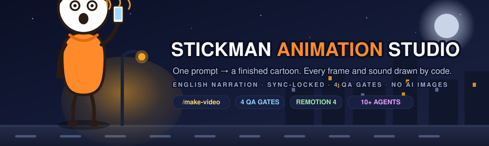
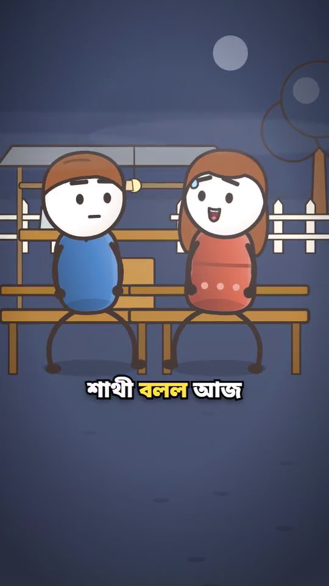
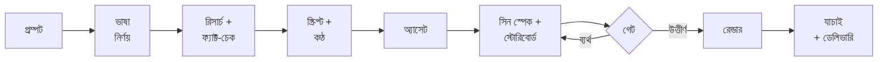
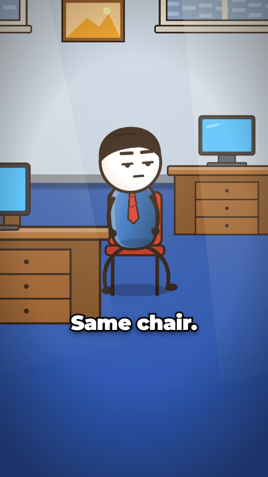
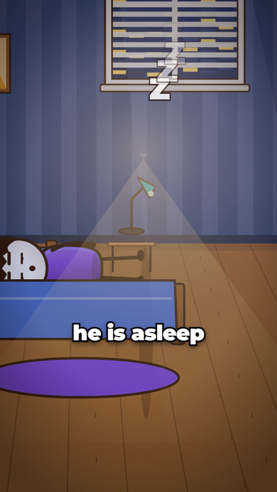
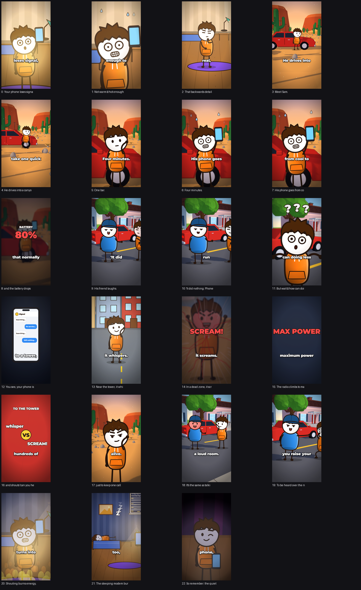

<div align="center">

<picture>
  <source media="(prefers-color-scheme: dark)" srcset="docs/banner-dark.svg">
  <source media="(prefers-color-scheme: light)" srcset="docs/banner-light.svg">
  
</picture>

[English](README.md) | [বাংলা](README.bn.md)

[](LICENSE)


[](https://github.com/god-dark-z/stickman-animation-studio/actions/workflows/ci.yml)


**একটি এআই এজেন্ট স্কিল, যা একটি প্রম্পট থেকে সম্পূর্ণ স্টিকম্যান কার্টুন বানায়।**
ডিফল্ট ইংরেজি, চাইলে বাংলা। প্রতিটি ফ্রেম ও প্রতিটি শব্দ কোডে তৈরি — কোনো ছবি বা ভিডিও
জেনারেটর নেই, কোনো পেইড এপিআই নেই।

</div>

---

## ডেমো

<div align="center">
<video src="docs/demo/demo.mp4" controls muted playsinline width="380"></video>

**`/make-video Why Does Your Phone Get Hot When Signal Is Weak?`** — ৫৬.৫ সেকেন্ড, ২৩ শট, ১০৮০×১৯২০, −১৪.৭ LUFS
</div>

<div align="center">


**`/make-video চায়ের দোকানে এক সকাল in Bangla`** — বাংলা কণ্ঠ, বাংলা ক্যাপশন, বাংলাদেশি পরিবেশ
</div>

পুরো গ্যালারি: [`docs/gallery.md`](docs/gallery.md)।

## এটি কী করে

- **গল্প লেখে।** ভাষা নির্ণয় করে, বিষয় নিয়ে রিসার্চ ও ফ্যাক্ট-চেক করে, গল্পের ফরম্যাট বেছে নেয়,
  আর নির্বাচিত কণ্ঠের মাপা শব্দ-বাজেট অনুযায়ী স্ক্রিপ্ট লেখে।
- **কোডে আঁকে।** Remotion + three.js ইঞ্জিন অ্যাঙ্কর করা প্রপে স্টিক ফিগার, প্যারালাক্স লোকেশন,
  প্রোসিডিউরাল মিউজিক আর ৬৫টি সিন্থেসাইজড সাউন্ড ইফেক্ট রেন্ডার করে।
- **মিথ্যা দেখিয়ে ডেলিভারি দেয় না।** বারোটি চলমান গেট ন্যারেশন-ছবির মিল, শরীর-প্রপের স্পর্শ,
  সাধারণ বোধের প্রত্যাশা, টাইমিং, পিক্সেল, লাউডনেস ও গ্লিফ কভারেজ যাচাই করে।

## কেন আলাদা

| | |
|---|---|
| **শুধু কোডে ছবি** | কোথাও এআই ইমেজ বা ভিডিও নেই। ১৬০টি প্রপ, ১৪টি লোকেশন, ২৩টি পোজের রিগ — সব কোডে লেখা। |
| **সাধারণ বোধ যাচাই করা** | ছবিটা দেখাতে হবে যা একজন মানুষ কল্পনা করবে: "অন্য ঘরে ঘুমিয়ে আছে" মানে বিছানা, তার উপর শরীর, আর **আলাদা** ঘর। ইংরেজি ৫৬ ও বাংলা ১০৮টি ইনটেন্ট এটি নিশ্চিত করে। |
| **যেকোনো এজেন্টে চলে** | একটি `SKILL.md` আর প্রতি এজেন্টের জন্য একটি পয়েন্টার ফাইল। ১০টি প্রোডাক্টের প্লেবুক, Claude Code থেকে শুধু চ্যাট উইন্ডো পর্যন্ত। |

## দ্রুত শুরু

```bash
# ১ — ইনস্টল
git clone https://github.com/god-dark-z/stickman-animation-studio
cd stickman-animation-studio/engine
npm install && pip install -r requirements.txt

# ২ — মেশিন পরীক্ষা (প্রতিটি সমস্যার সমাধানসহ PASS/WARN/FAIL)
npm run doctor

# ৩ — সাথে দেওয়া গল্পটি রেন্ডার
npx tsx scripts/studio.ts stories/why-phone-gets-hot.json --tier standard
```

এরপর আপনার এজেন্টের জন্য স্কিল ইনস্টল করুন — [`install/INSTALL.md`](install/INSTALL.md) — এবং ব্যবহার করুন:

```bash
/make-video Why does your phone get hot when signal is weak?
/make-video Why does your phone get hot when signal is weak? in Bangla
/make-video চায়ের দোকানে এক সকাল in Bangla
```

**ভাষা** আপনার কথার মধ্য থেকেই যন্ত্রের মতো নির্ণয় হয় (`npx tsx scripts/resolve_language.ts`)।
ডিফল্ট ইংরেজি; বাংলার জন্য স্পষ্ট অনুরোধ লাগে। শুধু বিষয় হিসেবে বাংলা থাকলে ("বাংলা সাহিত্য নিয়ে
একটি গল্প") ভিডিও ইংরেজিতেই হবে।

**কণ্ঠ** বিষয়ের সুর ও ধরন দেখে স্বয়ংক্রিয়ভাবে বাছা হয়, আর কারণ লেখা থাকে
`stories/<slug>/voice-decision.md`-এ। চাইলে বদলান:

```bash
npx tsx scripts/studio.ts stories/my-story.json --voice female --tier standard
npx tsx scripts/studio.ts stories/my-story.json --lang bn --voice bn-BD-PradeepNeural
```

## ভাষা সমর্থন

| ভাষা | কীভাবে চালু হয় | কণ্ঠ | কী কী বাংলায় |
|---|---|---|---|
| **ইংরেজি** (ডিফল্ট) | যেকোনো অনুরোধ | ৬টি edge-tts নিউরাল কণ্ঠ (৩ পুরুষ / ৩ নারী) | স্ক্রিপ্ট, কণ্ঠ, ক্যাপশন, ইনসার্ট, ইনটেন্ট গ্লসারি |
| **বাংলা** (অনুরোধে) | "in Bangla", "বাংলায় বানাও", "bangla te banao", `--lang bn` | ৪টি নিউরাল কণ্ঠ (বাংলাদেশ + ভারত, পুরুষ + নারী) | স্ক্রিপ্ট, কণ্ঠ, ক্যাপশন, **বান্ডল করা বাংলা ফন্ট**, বাংলা সংখ্যা, ৩৯২ শব্দের উচ্চারণ অভিধান, ১০৮টি ইনটেন্ট, ৪৯টি গল্পের ব্যাটারি |

একটি ভিডিওতে একটাই ভাষা। মেশানো নয়।

## পাইপলাইন



প্রতিটি ধাপ অর্কেস্ট্রেটরের একটিমাত্র কমান্ড, আর ব্যর্থ গেট পেরিয়ে সে এগোয় না:

```bash
npx tsx scripts/studio.ts <story.json> --tier draft|standard|studio
```

| গেট | কী প্রমাণ করে |
|---|---|
| `validate` | স্কিমা, প্রপ, কাস্ট, কণ্ঠ — সব আছে |
| `bangla` | পর্দায় একটাই লিপি, প্রতিটি শটে গ্লস, বাংলা অর্থ == ইংরেজি গ্লস |
| `glyphs` | পর্দার কোনো অক্ষরের গ্লিফ নেই — তা হয় না (টোফু বক্স নেই) |
| `sync` | প্রতিটি কথার দৃশ্য দেখা যায়: জায়গা, সময়, কাজ, বস্তু, সংলাপ, ধারাবাহিকতা |
| `geometry` | শরীর আসলে প্রপকে স্পর্শ করে; মাপ, স্তর ও ফ্রেমিং ঠিক |
| `commonsense` | শটটি মানুষের কল্পনার সাথে মেলে (সিন স্পেক + ইনটেন্ট গ্লসারি) |
| `stills` / `pixels` | কিছুই কালো, ফাঁকা বা স্থির নয় |
| `timing` | শব্দের সময় আসল কথার উপর পড়ে (মিডিয়ান ≤ ১২০ মি.সে.) |
| `video` / `audio` | ১০৮০×১৯২০ / ৩০ fps / h264+aac; −১৪ LUFS, ট্রু পিক ≤ −১.০ dBTP |
| `rubric` | প্রতি শটের কারিগরি স্কোর; কোনো শট ৩/৫-এর নিচে নয় |

## গ্যালারি

<div align="center">



</div>

## কোন কোন এজেন্টে চলে
<!-- এই রিপোজিটরিতে শুধু ZCode-এর রানটি সম্পূর্ণ চালানো হয়েছে; বাকিগুলো প্রোডাক্টের ডকুমেন্টেড লেআউট অনুসরণ করে। -->

| এজেন্ট | কীভাবে ডাকবেন | অবস্থা |
|---|---|---|
| ZCode | `/make-video <বিষয়>` | যাচাই করা (এই রিপোর রেফারেন্স রান) |
| Claude Code | `/make-video <বিষয়>` | ইনস্টলার `.claude/skills` + `.claude/commands` লেখে |
| Google Antigravity | `AGENTS.md` পয়েন্টার | প্রথা অনুযায়ী |
| Codex CLI | `AGENTS.md` পয়েন্টার | প্রথা অনুযায়ী |
| OpenCode | `AGENTS.md` + `.opencode/command/` | প্রথা অনুযায়ী |
| Cursor | `.cursor/rules/` + প্রম্পট | প্রথা অনুযায়ী |
| Gemini CLI | `GEMINI.md` + `/make-video` TOML | প্রথা অনুযায়ী |
| GitHub Copilot | `.github/copilot-instructions.md` | প্রথা অনুযায়ী |
| Windsurf | `.windsurf/rules/` + ওয়ার্কফ্লো | প্রথা অনুযায়ী |
| Aider | `--read AGENTS.md` | প্রথা অনুযায়ী |
| শুধু চ্যাট | `install/PASTE-THIS-PROMPT.md` পেস্ট করুন | শুধু স্ক্রিপ্ট + হ্যান্ডঅফ |

"প্রথা অনুযায়ী" মানে: লেআউটটি প্রোডাক্টের ডকুমেন্টেড নিয়ম অনুসরণ করে, কিন্তু এই রিপোজিটরিতে
সেই প্রোডাক্ট ইনস্টল না থাকায় চালিয়ে দেখা হয়নি। যাচাই না করা কিছু "যাচাই" বলে দাবি করা হয় না।

## প্রতি রানে যা পাবেন

| ফাইল | কী |
|---|---|
| `out/<slug>/<slug>.mp4` | যাচাই করা ভিডিও, ১০৮০×১৯২০, ৩০ fps, H.264 + AAC |
| `stories/<slug>/script.md` | বিটসহ স্ক্রিপ্ট (বাংলা হলে ইংরেজি গ্লস কলামসহ) |
| `stories/<slug>/fact-check.md` | প্রতিটি তথ্য ও তার সূত্র |
| `stories/<slug>/sync-map.md` | শট-ধরে-শট ন্যারেশন↔ছবির চুক্তি |
| `stories/<slug>/voice-decision.md` | কোন কণ্ঠ, কেন, স্কোরসহ |
| `<title>.json` (+ `.spec.json`) | গল্প ও সিন স্পেক, পুনরুৎপাদনযোগ্য |
| `out/<slug>/craft-rubric.md` | প্রতি শটের কারিগরি স্কোর |
| `out/<slug>/contact-sheet.png` | এক নজরে সব শট |

## পারফরম্যান্স ও প্রয়োজন

রেফারেন্স মেশিনে মাপা: **শুধু সিপিইউ, Ryzen 7 5700G, ১৬ জিবি, ইন্টিগ্রেটেড গ্রাফিক্স**।

| | |
|---|---|
| ফুল-কোয়ালিটি ইংরেজি ডেমো (৫৬.৫ সে., ২৩ শট) | **২ মিনিট ৪ সেকেন্ড** (১০৮০×১৯২০) |
| ড্রাফট টায়ার (৫৪০×৯৬০) | একই গল্প এক মিনিটের কমে |
| র‍্যাম | কনকারেন্সি ২-এ প্রায় ৫ জিবি খালি দরকার (ইঞ্জিন খালি র‍্যাম দেখে সীমা ঠিক করে) |
| Node / Python | Node ১৮+ (পরীক্ষিত ২৪), Python ৩.১০+ (পরীক্ষিত ৩.১২) |
| ডিস্ক | `node_modules` + Chromium-এ ~৩ জিবি; প্রতিটি শেষ ভিডিও ~৬৫ মেগাবাইট |
| ইন্টারনেট | শুধু ন্যারেশন (ফ্রি edge-tts) ও রিসার্চে; `--no-tts` পুরোপুরি অফলাইনে রেন্ডার করে |

কোনো জিপিইউ নেই। Blender নেই। কোনো এপিআই কী নেই।

## ডকুমেন্টেশন

| | |
|---|---|
| [INSTALL](install/INSTALL.md) | প্রতি এজেন্টে ইনস্টল; কোনটা যাচাই করা, কোনটা প্রথা |
| [TROUBLESHOOTING](docs/TROUBLESHOOTING.md) | বাস্তবে যে সমস্যাগুলো আসবে |
| [এজেন্ট প্লেবুক](docs/agents/README.md) | প্রতি প্রোডাক্টের সামর্থ্য ও সতর্কতা |
| [রেফারেন্স](references/) | ১৪টি কারিগরি রেফারেন্স: অ্যানিমেশন, চরিত্র, ক্যামেরা, স্ক্রিপ্ট, সাউন্ড, QA, অ্যাসেট, স্কিমা, ইনটেন্ট, বাংলা, ফরম্যাট, টায়ার |
| [ইভাল রিপোর্ট](evals/REPORT.md) | প্রতিটি মাপা স্যুট ও হার |
| [থার্ড-পার্টি নোটিশ](THIRD_PARTY.md) | ফন্ট ও ডিপেন্ডেন্সি, লাইসেন্সসহ |
| [চেঞ্জলগ](CHANGELOG.md) | v4-এ কী বদলাল |
| [কন্ট্রিবিউটিং](CONTRIBUTING.md) | নতুন ভাষা, প্রপ, ইনটেন্ট যোগ করা |

## সাধারণ প্রশ্ন

**ছবি বা ভিডিও বানাতে এআই ব্যবহার করে?** না। প্রতিটি ফ্রেম কোডে আঁকা, প্রতিটি শব্দ সিন্থেসাইজড।
প্রোডাকশনে একমাত্র নেটওয়ার্ক কল ফ্রি টেক্সট-টু-স্পিচ।

**সত্যিই বাংলা ভিডিও বানাতে পারে?** হ্যাঁ — বাংলা স্ক্রিপ্ট, বিষয় দেখে বাছা বাংলা কণ্ঠ, বান্ডল করা
বাংলা ফন্টে বাংলা সংখ্যাসহ ক্যাপশন, আর ইংরেজির মতোই সব গেট। স্পষ্ট করে বলুন:
`/make-video <বিষয়> in Bangla`।

**জিপিইউ লাগবে?** না। শুধু সিপিইউ, ১৬ জিবি মেশিনের জন্য টিউন করা।

**কেন স্টিকম্যান?** কারণ স্টিক ফিগার কোডে নির্ভরযোগ্যভাবে আঁকা যায়, তাই কারিগরি থাকতে হয়
স্টেজিং, টাইমিং আর সাউন্ডে — যেখানে থাকা উচিত।

**নিজের বিষয় দিতে পারি?** পারবেন: স্কিল ইনস্টল করে `/make-video <আপনার বিষয়>`, বা নিজেই স্টোরি
JSON লিখুন — স্কিমা রেফারেন্স ও গেট বলে দেবে কী ভুল।

## রোডম্যাপ

- আরও তিনটি ইংরেজি বিষয় ফুল কোয়ালিটিতে, আগে-পরে স্কোরসহ।
- একটি বাংলা ৩ডি রাস্তার লোকেশন (প্রপ ২ডিতে আছে, লোকেশন নেই)।
- প্রতি ভিডিওতে অন্তত একটি শটে রচিত — শুধু স্বয়ংক্রিয় নয় — সাউন্ড ডিজাইন।
- অপারেটররা `engine/scripts/eval.ts` দিয়ে প্রতি-মডেল ইভাল সারি ভরবেন।

## অবদান

[`CONTRIBUTING.md`](CONTRIBUTING.md) দেখুন। সংক্ষেপে: পুল রিকোয়েস্টের আগে `npm test`, `npm run eval`
আর `npx tsx scripts/skill_lint.ts` চালান। নতুন ভাষা যোগ করা একটি ডেটা কাজ, ফর্ক নয়।

## লাইসেন্স ও কৃতিত্ব

MIT — [LICENSE](LICENSE) দেখুন। ফন্ট (Noto Sans Bengali, Hind Siliguri, Baloo Da 2, Montserrat)
SIL OFL 1.1 লাইসেন্সে; প্রতিটি ডিপেন্ডেন্সি ও অ্যাসেট [THIRD_PARTY.md](THIRD_PARTY.md)-এ লেখা।
বাংলা কণ্ঠের তালিকা অনুপ্রাণিত
[parvez144/text-to-speech-with-edge-tts](https://github.com/parvez144/text-to-speech-with-edge-tts)
থেকে (সেখানে লাইসেন্স নেই, তাই কোনো কোড কপি করা হয়নি — ইঞ্জিনটি আচরণটি নতুন করে লিখেছে)।

### সৎ সীমাবদ্ধতা

- অ্যাঙ্কর-ভিত্তিক কাজ (বসা, শোয়া) শুধু ২ডিতে; ৩ডি লোকেশনে গেট `ANCHOR-3D` তোলে, শরীর ভুল জায়গায়
  বসায় না।
- রিগটি ২ডি কাট-আউট: আলাদা থাই নেই, লিপ-সিঙ্ক ভিসিম নেই (মুখের নড়াচড়া অডিও অনুসরণ করে)।
- অ্যাঙ্কর টেবিল হাতে মাপা, আঁকার কোড থেকে; নতুন আসনের অ্যাঙ্কর যোগ করতে হয়।
- হাতের ভিড়, কাপড়ের ফিজিক্স বা তরল — কোডে আঁকা স্টিক ফিগারের জন্য এর বাইরে।
