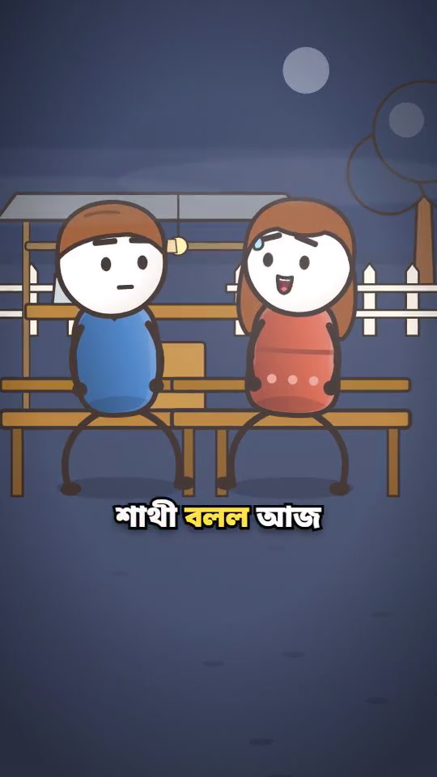
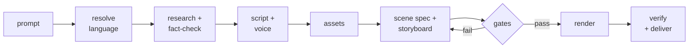

<div align="center">

<picture>
  <source media="(prefers-color-scheme: dark)" srcset="docs/banner-dark.svg">
  <source media="(prefers-color-scheme: light)" srcset="docs/banner-light.svg">
  
</picture>

[English](README.md) | [বাংলা](README.bn.md)

[](LICENSE)


[](https://github.com/god-dark-z/stickman-animation-studio/actions/workflows/ci.yml)


**A skill for AI coding agents that turns one prompt into a finished stickman cartoon.**
English by default, Bangla (বাংলা) on request. Every frame and every sound drawn and synthesized by
code — no image models, no video models, no paid APIs.

</div>

---

## Demo

<div align="center">
<video src="docs/demo/demo.mp4" controls muted playsinline width="380"></video>

**`/make-video Why Does Your Phone Get Hot When Signal Is Weak?`** — 56.5 s, 23 shots, 1080×1920, −14.7 LUFS
</div>

<div align="center">


**`/make-video চায়ের দোকানে এক সকাল in Bangla`** — Bangla voice, Bangla captions, Bengali settings
</div>

Full gallery: [`docs/gallery.md`](docs/gallery.md).

## What it does

- **Writes the film.** Resolves the language, researches and fact-checks the topic, picks a story
  format, and writes the script to the measured word budget of the chosen voice.
- **Draws it by code.** A Remotion + three.js engine renders stick figures on anchored props,
  parallax locations, procedural music and 65 synthesized sound effects.
- **Refuses to ship a lie.** Twelve executable gates check narration-to-picture sync, body-to-prop
  contact, commonsense expectations, timing, pixels, loudness and glyph coverage.

## Why it's different

| | |
|---|---|
| **Code-only visuals** | No AI image or video generation anywhere. 160 props, 14 locations, a rig with 23 poses — all authored as code. |
| **Commonsense-checked** | The film must show what a human would picture: "asleep in the other room" needs a bed, a body on it and a *different* room. 56 English + 108 Bangla intents enforce it. |
| **Works in any agent** | One `SKILL.md` plus a pointer file per agent. Playbooks for 10 products, from Claude Code to a chat window. |

## Quick start

```bash
# 1 — install
git clone https://github.com/god-dark-z/stickman-animation-studio
cd stickman-animation-studio/engine
npm install && pip install -r requirements.txt

# 2 — check the machine (PASS/WARN/FAIL with a fix for each)
npm run doctor

# 3 — render the shipped story
npx tsx scripts/studio.ts stories/why-phone-gets-hot.json --tier standard
```

Then install the skill for your agent — see [`install/INSTALL.md`](install/INSTALL.md) — and use it:

```bash
/make-video Why does your phone get hot when signal is weak?
/make-video Why does your phone get hot when signal is weak? in Bangla
/make-video চায়ের দোকানে এক সকাল in Bangla
```

**Language** is resolved mechanically from your words (`npx tsx scripts/resolve_language.ts`).
English is the default; Bangla needs an explicit request. A topic that merely *mentions* Bangla
("a story about Bangla literature") stays English.

**Voice** is chosen automatically from the topic's tone and genre, and the reason is written to
`stories/<slug>/voice-decision.md`. Override it:

```bash
npx tsx scripts/studio.ts stories/my-story.json --voice female --tier standard
npx tsx scripts/studio.ts stories/my-story.json --lang bn --voice bn-BD-PradeepNeural
```

## Language support

| Language | Trigger | Voices | What is localized |
|---|---|---|---|
| **English** (default) | any request | 6 edge-tts neural voices (3 male / 3 female) | script, voice, captions, inserts, intent glossary |
| **বাংলা** (on request) | "in Bangla", "বাংলায় বানাও", "bangla te banao", `--lang bn` | 4 neural voices (BD + IN, male + female) | script, voice, captions, **bundled Bengali fonts**, Bangla digits, 392-entry pronunciation dictionary, 108 intents, 49-story battery |

One language per video. Never mixed.

## Pipeline



Every stage is one call to the orchestrator, which refuses to advance past a failed gate:

```bash
npx tsx scripts/studio.ts <story.json> --tier draft|standard|studio
```

| Gate | What it proves |
|---|---|
| `validate` | schema, props, cast, voices exist |
| `bangla` | one script on screen, every shot glossed, Bangla meaning == English gloss |
| `glyphs` | no character on screen lacks a glyph (no tofu boxes) |
| `sync` | every spoken line is shown: place, time, action, objects, dialogue, continuity |
| `geometry` | bodies actually touch their props; scale, layering, framing are sane |
| `commonsense` | the shot matches what a human would picture (Scene Spec + intent glossary) |
| `stills` / `pixels` | nothing black, blank or dead |
| `timing` | word timings land on real speech (median ≤ 120 ms) |
| `video` / `audio` | 1080×1920 / 30 fps / h264+aac; −14 LUFS, true peak ≤ −1.0 dBTP |
| `rubric` | per-shot craft score; no shot below 3/5 |

## Gallery

<div align="center">


</div>

## Works with
<!-- Only the ZCode run in this repository was executed end to end; the rest follow each product's documented layout. -->

| Agent | How to invoke | Status |
|---|---|---|
| ZCode | `/make-video <topic>` | verified (this repo's reference run) |
| Claude Code | `/make-video <topic>` | installer writes `.claude/skills` + `.claude/commands` |
| Google Antigravity | `AGENTS.md` pointer | by convention |
| Codex CLI | `AGENTS.md` pointer | by convention |
| OpenCode | `AGENTS.md` + `.opencode/command/` | by convention |
| Cursor | `.cursor/rules/` + prompt | by convention |
| Gemini CLI | `GEMINI.md` + `/make-video` TOML | by convention |
| GitHub Copilot | `.github/copilot-instructions.md` + prompt file | by convention |
| Windsurf | `.windsurf/rules/` + workflow | by convention |
| Aider | `--read AGENTS.md` | by convention |
| Chat only | paste `install/PASTE-THIS-PROMPT.md` | script + handoff only |

<details>
<summary>What "by convention" means</summary>

The layout follows each product's documented model of instructions and skills. It has **not** been
executed on those products in this repository, because they are not installed here. Nothing above
claims a verified install that was not run. Per-agent playbooks:
[`docs/agents/`](docs/agents/README.md).
</details>

## What you get per run

| File | What it is |
|---|---|
| `out/<slug>/<slug>.mp4` | the verified video, 1080×1920, 30 fps, H.264 + AAC |
| `stories/<slug>/script.md` | the script with beats (Bangla: with an English gloss column) |
| `stories/<slug>/fact-check.md` | every claim with its source |
| `stories/<slug>/sync-map.md` | the shot-by-shot narration↔visual contract |
| `stories/<slug>/voice-decision.md` | which voice, and why, with the score |
| `<title>.json` (+ `.spec.json`) | the story and the Scene Spec, reproducible |
| `out/<slug>/craft-rubric.md` | per-shot craft scores |
| `out/<slug>/contact-sheet.png` | every shot at a glance |

## Performance and requirements

Measured on the reference profile: **CPU-only, Ryzen 7 5700G, 16 GB, integrated graphics**.

| | |
|---|---|
| Full-quality English demo (56.5 s, 23 shots) | **2 min 4 s** at 1080×1920 |
| Draft tier (540×960) | under a minute for the same story |
| RAM | ~5 GB free at concurrency 2 (the engine caps by free RAM) |
| Node / Python | Node 18+ (tested 24), Python 3.10+ (tested 3.12) |
| Disk | ~3 GB for `node_modules` + Chromium; ~65 MB per finished video |
| Internet | only for narration (free edge-tts) and research; `--no-tts` renders fully offline |

No GPU. No Blender. No API keys.

## Docs

| | |
|---|---|
| [INSTALL](install/INSTALL.md) | install per agent; verified vs by-convention |
| [TROUBLESHOOTING](docs/TROUBLESHOOTING.md) | the failures you will actually hit |
| [Agent playbooks](docs/agents/README.md) | per-product capabilities and pitfalls |
| [References](references/) | 14 craft references: animation, characters, camera, script, sound, QA, assets, schema, intents, Bangla, formats, tiers |
| [Eval report](evals/REPORT.md) | every measured suite and rate |
| [Third-party notices](THIRD_PARTY.md) | fonts and dependencies, with licences |
| [Changelog](CHANGELOG.md) | what changed in v4 |
| [Contributing](CONTRIBUTING.md) | add a language, a prop, an intent |

## FAQ

**Does it use AI to generate images or video?** No. Every frame is drawn by code and every sound is
synthesized. The only network call for production is free text-to-speech.

**Can it really make Bangla videos?** Yes — Bangla script, a Bangla voice chosen from the topic,
Bangla captions in bundled Bengali fonts with Bangla digits, and the same gates as English. Ask
explicitly: `/make-video <topic> in Bangla`.

**Do I need a GPU?** No. It is tuned for a CPU-only 16 GB machine.

**Why stickman?** A stick figure can be drawn reliably by code, so the craft has to live in staging,
timing and sound — where it belongs.

**Can I use my own topic?** Yes: install the skill and `/make-video <your topic>`, or write the story
JSON yourself — the schema reference and the gates tell you what is wrong.

## Roadmap

- Three more English topics at full quality with published before/after scores.
- A Bengali 3D street location (the props exist in 2D; the location does not).
- Composed — not only automatic — sound design for at least one shot per video.
- Per-model eval rows filled in by operators, from `engine/scripts/eval.ts`.

## Contributing

See [`CONTRIBUTING.md`](CONTRIBUTING.md). Short version: run `npm test`, `npm run eval` and
`npx tsx scripts/skill_lint.ts` before a pull request. Adding a language is a data task, not a fork.

## License and credits

MIT — see [LICENSE](LICENSE). Fonts (Noto Sans Bengali, Hind Siliguri, Baloo Da 2, Montserrat) are
SIL OFL 1.1; every dependency and asset is listed in [THIRD_PARTY.md](THIRD_PARTY.md). The Bangla
voice list was inspired by
[parvez144/text-to-speech-with-edge-tts](https://github.com/parvez144/text-to-speech-with-edge-tts)
(no licence there, so no code was copied — the engine re-implements the behaviour).

### Honest limits

- Anchor actions are 2D-only; in a 3D location the gate raises `ANCHOR-3D` rather than misplacing a body.
- The rig is a 2D cut-out: no separate thigh, no lip-sync visemes (mouth flaps follow the audio).
- Anchor tables are measured by hand from the drawing code; a new seat needs its anchors added.
- Sticks cannot do crowds-of-hands, cloth physics or liquids — out of scope for a code-drawn figure.
