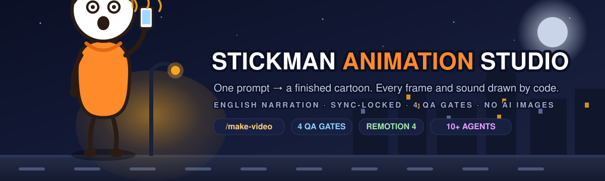
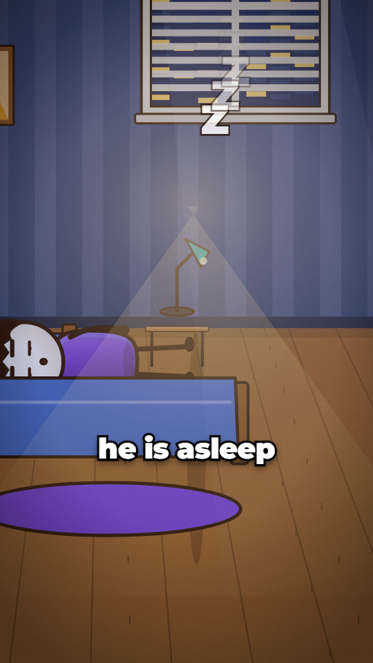
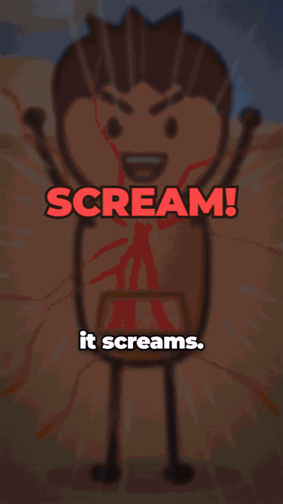
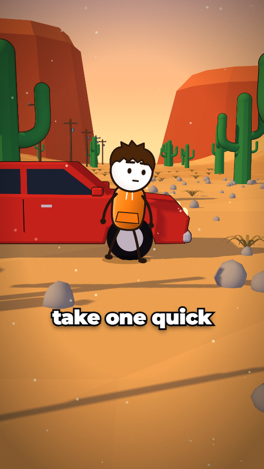
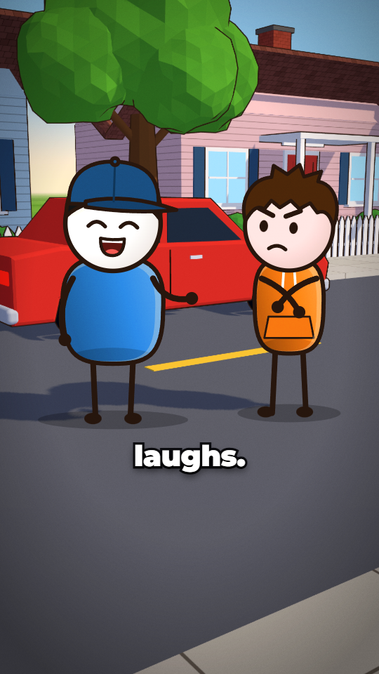
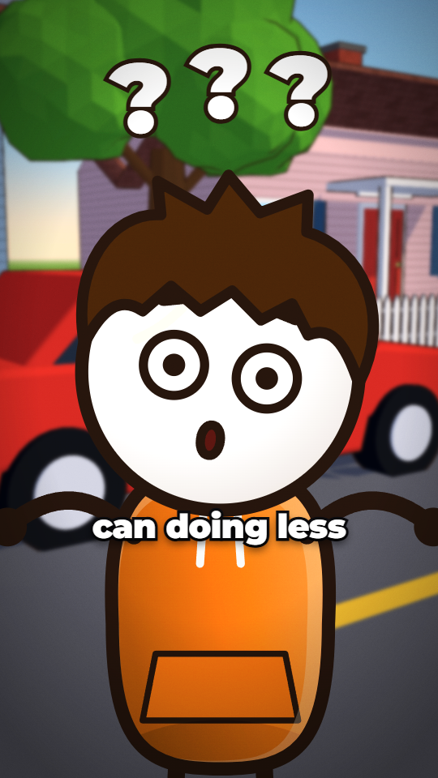
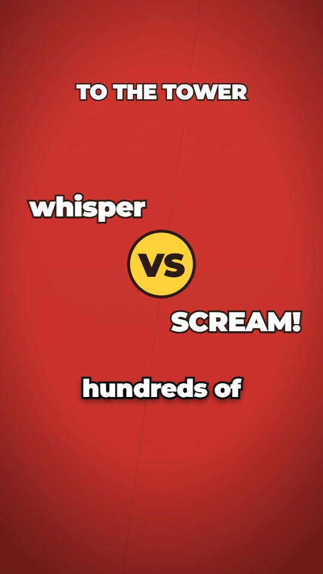
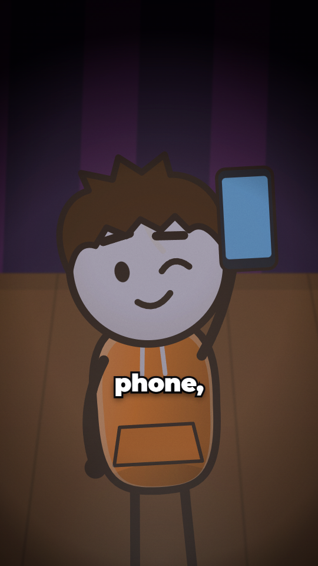
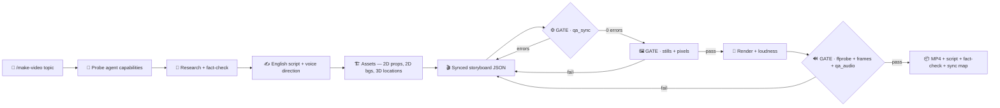

<div align="center">



[](LICENSE)


[](install/INSTALL.md)

**An AI-agent skill that turns one prompt into a finished, studio-grade stickman cartoon —
English-narrated, narration-synced, every frame and every sound produced by code.**

</div>

---

## 🎬 The demo — real output from this repo

The video below was rendered by the actual pipeline in this repository (v3, regenerated
2026-11-24) — no external tools, no image or video models. It is the `draft` tier (540×960) of the
shipped example storyboard, run through every gate; `--tier standard` renders the same thing at
1080×1920.

### Seating and sleeping, proven

These are the cases that used to pass the old gates with a wrong picture — a character “sleeping”
drawn on the floor beside the bed, a character “sitting” sunk into the chair. Now the engine
resolves the body onto the prop's anchors and a geometry gate checks the drawing.

<div align="center">




*full-body seated · asleep in bed, head on pillow · every demo shot at a glance*
</div>

<div align="center">

<video src="docs/demo/demo.mp4" controls muted playsinline width="400"></video>

**`/make-video Why Does Your Phone Get Hot When Signal Is Weak?`** · 56.5 s · 23 shots · H.264 + AAC · −14.7 LUFS · rendered in 108 s on a CPU-only machine

<br/>




*Left: the 3D location system with 2D characters composited in. Right: programmatic insert graphics.*

</div>

### Every frame of the demo, QA-checked

| | | | |
|:---:|:---:|:---:|:---:|
|  |  |  |  |
| *paradox hook, close-up* | *character reveal* | *3D location + car* | *narration-synced prop* |
|  |  |  |  |
| *two-shot + quote mouth* | *crash-zoom punchline* | *reaction acting* | *insert graphic* |
|  |  |  |  |
| *versus board* | *fire fx on night grade* | *locked night palette* | *spotlight payoff* |

Each still passed three checks: the **sync gate** (narration ↔ visual contract), the **pixel gate**
(exposure/black/saturation), and offline CV structural checks.

---

## Why this is different

| | |
|:---|:---|
| 🎨 **Zero generative imagery** | Characters, backgrounds, props, motion, music and SFX are all drawn and synthesized by code (SVG + three.js + numpy). The look is consistent *by construction*, not by prompt luck. |
| 🔒 **Sync-locked storytelling** | Shots are timed to the spoken word via TTS timestamps, and a lexicon-based validator proves the visuals show what the narration says — places, times, actions, objects, dialogue. Contradictions fail the build. |
| 🤖 **Agent-agnostic by design** | The skill probes whatever agent executes it (search? vision? background tasks?) and adapts — but the quality gates never bend. 10+ adapters, one pipeline, one quality bar. |

## The pipeline



## The executable QA gates

| Gate | Command | Enforces |
|---|---|---|
| **Validate** | `npx tsx scripts/validate.ts stories/x.json` | schema, cast ids, prop ids, 3D locations, quote actors — before anything expensive runs |
| **Sync** | `npx tsx scripts/qa_sync.ts stories/x.json` | narration ↔ visual contract: places, time-of-day, actions as poses/beats, objects, quoted lines with animated mouths, continuity, shot-grammar repetition |
| **Geometry** | `npx tsx scripts/qa_geometry.ts stories/x.json` | **the scene graph**: hip inside the seat, body on the mattress, head on the pillow, no sinking/floating, scale, draw order, face occlusion, framing, facing, seated→standing continuity. Runs the same placement code as the renderer |
| **Stills** | `npm run make -- … --stills` → `python scripts/qa_stills.py …` | exposure / dead-frame / saturation pixel gate |
| **Timing** | `python scripts/qa_timing.py out/slug/words.json out/…mp3` | per-word timing is real (not sentence-level), monotonic, and each sampled word lands on audible speech |
| **Video** | `python scripts/qa_video.py out/slug.mp4` | codec, fps, resolution, duration ≈ timeline, dead frames |
| **Audio** | `python scripts/qa_audio.py out/slug.mp4` | −14 LUFS ±1.5, true peak ≤ −1.0 dBTP, voice presence |
| **Visual** | `python scripts/qa_visual_report.py story.json out/slug/stills` | contact sheet + per-shot claim checklist; a vision agent records PASS/FAIL, a vision-less agent states that QA was geometric only |

`npm run studio -- <story> --tier draft` runs them all in order and refuses to advance past a
failure. Repairs loop per gate; nothing ships with a silently failed gate.

## Install

```bash
git clone https://github.com/god-dark-z/stickman-animation-studio
cd your-project
../stickman-animation-studio/install/install.sh --with-engine     # Windows: install.ps1 -WithEngine

cd engine
npm ci                                   # exact versions from package-lock.json
python -m pip install -r requirements.txt   # pinned Python deps
npm run doctor                           # PASS/WARN/FAIL before you render anything
```

Then one command per video:

```bash
npm run studio -- stories/tests/chair-office.json --tier draft   # fast, half-size
npm run studio -- stories/my-story.json --tier standard          # 1080x1920
```

The installer places the skill files, `/make-video` command adapters for every supported agent,
and pointer rules — idempotent, safe to re-run. Full details and a per-agent compatibility table:
**[install/INSTALL.md](install/INSTALL.md)**.

## Agent compatibility

| Agent | Invocation | Route |
|---|---|---|
| Claude Code · ZCode | `/make-video` ✅ native | skill + command auto-discovered |
| OpenCode · Cursor 1.6+ | `/make-video` | `.opencode/command/` · `.cursor/commands/` |
| VS Code Copilot | `/make-video` in chat | `.github/prompts/make-video.prompt.md` |
| Gemini CLI | `/make-video` | `.gemini/commands/make-video.toml` |
| Codex CLI · DeepSeek · Antigravity · AGENTS.md readers | "make a video about X" | `AGENTS.md` pointer |
| Windsurf · Aider | "make a video about X" | rules / conventions pointer |
| Chat-only agents (no filesystem) | paste prompt | [`install/PASTE-THIS-PROMPT.md`](install/PASTE-THIS-PROMPT.md) — pre-production package, render handed to a coding agent |

Statuses are marked honestly (verified vs. by-convention) in INSTALL.md. All routes converge on
the same `SKILL.md` pipeline and the same gates — output quality is agent-independent by construction.

## What one run delivers

| Deliverable | Where |
|---|---|
| 🎥 Finished MP4 — 1080×1920, 30 fps, H.264 + AAC, −14 LUFS | `engine/out/<slug>/<slug>.mp4` |
| 📝 English narration script | `engine/stories/<slug>/script.md` |
| ✅ Fact-check table with source links | `engine/stories/<slug>/fact-check.md` |
| 🔒 Sync map — the shot-by-shot narration↔visual contract | `engine/stories/<slug>/sync-map.md` |
| 🧩 Reusable storyboard JSON + any new library assets | `engine/stories/` · `engine/locations/` |

## Voice & sound, directed

| Genre | Voice | Rate | Read |
|---|---|---|---|
| Punchy storytelling *(default)* | `en-US-AndrewMultilingualNeural` | +22% | energetic narrator |
| Calm documentary | `en-US-ChristopherNeural` | +6…10% | measured, grave |
| Bright educational | `en-US-AriaNeural` | +12% | classroom-clear |
| Dramatic recitation | `en-US-GuyNeural` | +8% | weight for history |

65 SFX and 6 music beds are synthesized procedurally (numpy) — soft envelopes, normalized below
clipping, royalty-free by construction. Music and effects duck under the voice automatically.

## Repository layout

```
SKILL.md                     the agent-facing pipeline definition (/make-video)
references/                  10 production references (principles · rig · camera · script · sync · sound · QA · assets · schema · voice)
commands/make-video.md       slash-command body (adapted per agent by the installer)
install/                     install.sh · install.ps1 · INSTALL.md · PASTE-THIS-PROMPT.md
engine/                      the portable render engine (Remotion 4 + three.js)
  scripts/                   make.ts · tts.py · gen_audio_assets.py · qa_sync.ts · qa_stills.py · qa_audio.py · test.ts
  src/                       character rig · scenes · camera · fx · inserts · captions · 3D
  stories/                   demo.json · why-phone-gets-hot.json (gate-passing worked example)
  locations/                 13 starter 3D locations + shared object library
templates/                   sync-map.md · fact-check-table.md
docs/                        banner.svg (drawn in code) · demo/ (video, GIFs, QA stills)
```

## Verified — v3, measured on a CPU-only machine (2026-11-24)

Machine: Windows 11, 16 cores, **~15 GB RAM, no discrete GPU**, CPU-only. Every number below was
produced by a command in `docs/dev/VERIFY-*.md`; nothing here is self-reported from a build day.

- [x] `tsc --noEmit` clean · **22/22** unit tests (incl. numeric contact tests for chair and bed)
- [x] **Full 23-shot demo** (`--tier draft`, 3D locations, software WebGL via ANGLE): timeline 56.4 s,
      **108 s wall clock**, 3.8 MB MP4, **all gates PASS**
- [x] Sync gate **0 errors, 0 warnings** · geometry gate **0 errors, 0 warnings** on the demo
- [x] Timing audit: 188 words, median word 205 ms, mean distance to a speech onset **55 ms**
- [x] Video gate PASS: 540×960, 30.00 fps, h264 + aac, 56.5 s, 0 dead-frame runs ≥ 0.6 s
- [x] Audio gate PASS: **−14.7 LUFS**, **−1.5 dBTP**
- [x] Seating and sleeping fixtures: character **visibly and numerically** on the chair / in the bed
      (see `docs/showcase/`)
- [x] `npm run doctor` → **15 checks, 0 fail, 0 warn** on the reference machine (an earlier probe hit
the provider's intermittent `NoAudioReceived`; the probe retries and narrates the hint instead of
failing)

### Measured render times (this machine)

| Work | Tier | Output | Wall clock |
|---|---|---|---|
| 1-shot silent edge case | draft | 540×960, 1.6 s | **18 s** total (6 s encode) |
| 4-shot bed scene, real TTS | draft | 540×960, 9.2 s | **~60 s** total (19 s after narration) |
| 23-shot demo, 3D, real TTS | draft | 540×960, 56.5 s | **108 s** total |
| 1080×1920 full quality | standard | — | not measured on this machine; see `docs/dev/BLOCKERS.md` |

The renderer caps concurrency by **free RAM as well as cores** (a 1080×1920 three.js frame costs
~250–350 MB per tab) and drops to 2 workers when a shot uses a 3D location.

## Requirements

Node 18+ (tested on 24.19) · Python 3.10+ (tested on 3.12) · ~3 GB disk · full FFmpeg on PATH for
the video gate. Remotion downloads its own headless Chromium on first render. Narration uses free
Microsoft edge-tts (needs internet; `--no-tts` works fully offline). Software WebGL is the
supported path — **no GPU required**.

**English-only production. No AI image/video generation, no image services, no paid APIs — ever.**

## What this cannot do (honest limits)

- **Anchor actions are 2D-only.** `sitOn` / `lieOn` / `sleepOn` resolve against 2D prop anchors. In a
  3D location the gate raises `ANCHOR-3D` instead of misplacing a body; use a 2D background for
  those shots.
- **The rig is a 2D cut-out.** A seated silhouette is correct in contact and scale but the legs are
  a single curve — there is no separate thigh, so extreme close-ups of a seated pose read less well
  than a wide or medium shot.
- **Anchor tables are measured by hand** from `Props.tsx` and currently cover chair, stool, bench,
  couch, bed, desk, table and the vehicles. A new piece of furniture needs its anchors added before
  a character can sit on it.
- **No lip-sync phonemes.** Mouth flaps are amplitude-driven from the narration audio, not visemes.
- **No pathological content**: crowds, crowds-of-hands, cloth, hair physics and liquid are out of
  scope for a code-drawn stickman engine.
- **Per-agent installs were not executed** for Claude Code / Antigravity / ZCode in this build; see
  `install/INSTALL.md` for which routes are convention-only.

## License & credits

MIT — see [LICENSE](LICENSE). All audio is procedural; all graphics are original SVG/JSON in this repo.
Architecture and craft extracted from the *BEANMEN ANIMATION* production system by the same author,
adapted and hardened for public release.
