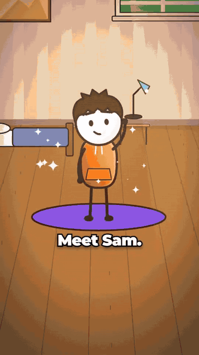
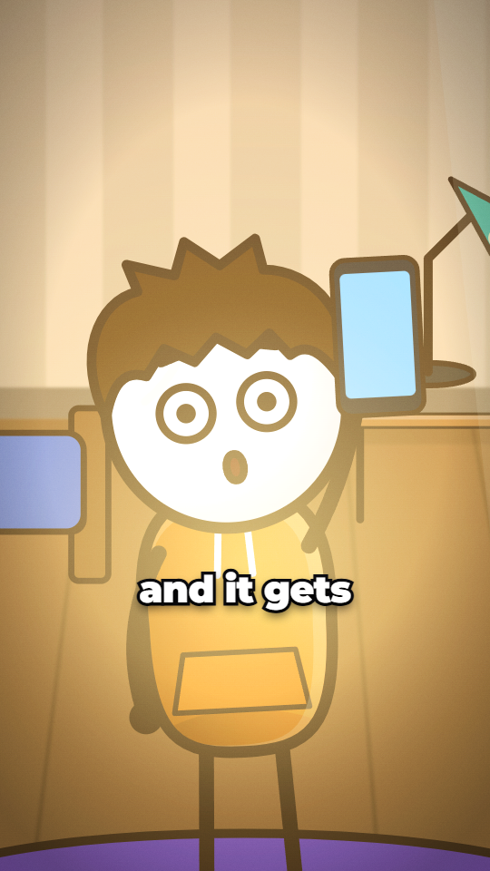
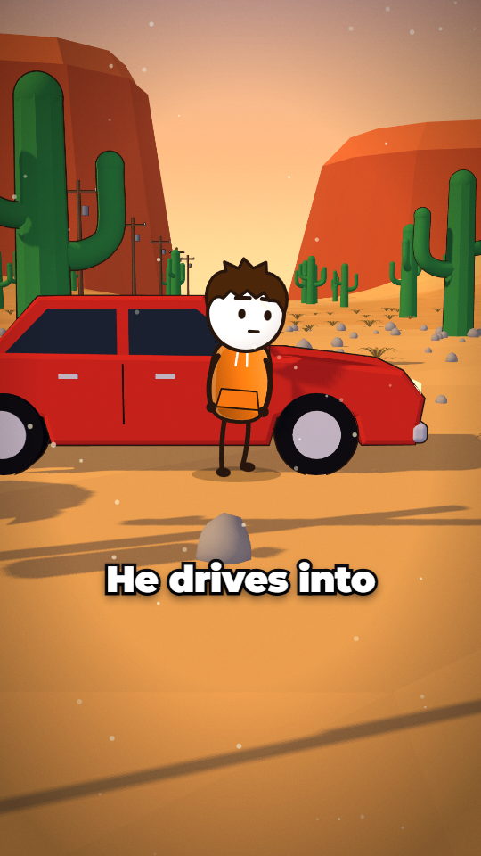
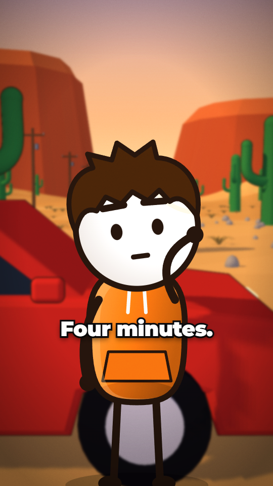
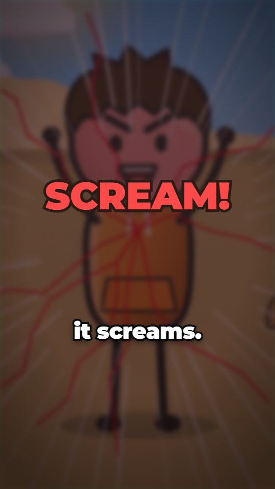
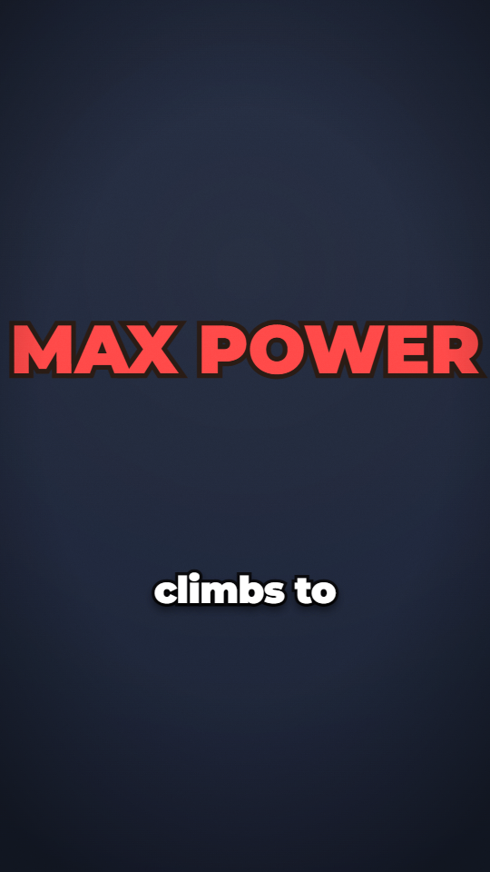
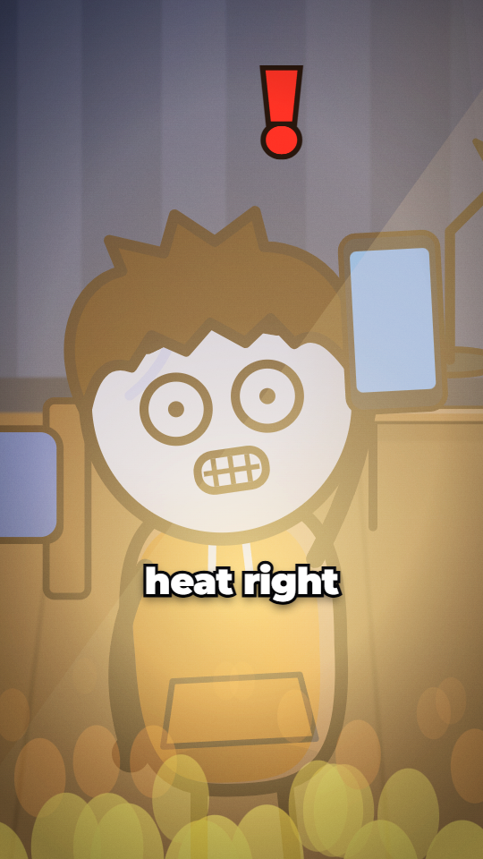
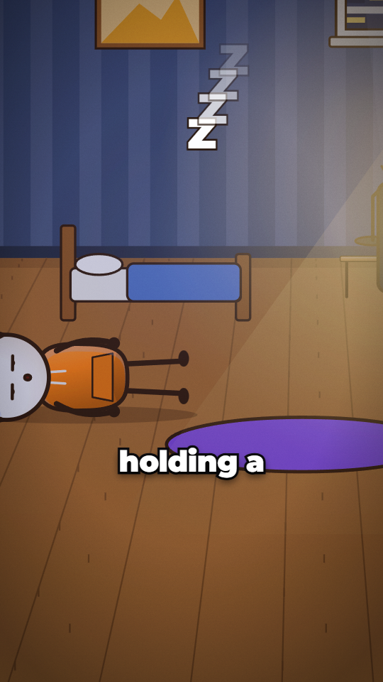
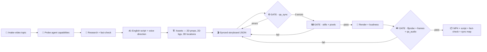

<div align="center">


[](LICENSE)


[](install/INSTALL.md)

**An AI-agent skill that turns one prompt into a finished, studio-grade stickman cartoon —
English-narrated, narration-synced, every frame and every sound produced by code.**

</div>

---

## 🎬 The demo — real output from this repo

The video below was rendered by the actual pipeline in this repository —
no external tools, no image or video models. It is the `--preview` pass (540×960) of the shipped
example storyboard; a full run renders the same thing at 1080×1920.

<div align="center">

<video src="docs/demo/demo.mp4" controls muted playsinline width="400"></video>

**`/make-video Why Does Your Phone Get Hot When Signal Is Weak?`** · 56 s · 23 shots · H.264 + AAC · −14.7 LUFS

<br/>




*Left: the 3D location system with 2D characters composited in. Right: programmatic insert graphics.*

</div>

### Every frame of the demo, QA-checked

| | | | |
|:---:|:---:|:---:|:---:|
|  |  |  |  |
| *paradox hook, close-up* | *character reveal* | *3D location + car* | *narration-synced prop* |
|  |  |  |  |
| *two-shot + quote mouth* | *crash-zoom punchline* | *reaction acting* | *insert graphic* |
|  |  |  |  |
| *versus board* | *fire fx on night grade* | *locked night palette* | *spotlight payoff* |

Each still passed three checks: the **sync gate** (narration ↔ visual contract), the **pixel gate**
(exposure/black/saturation), and offline CV structural checks.

---

## Why this is different

| | |
|:---|:---|
| 🎨 **Zero generative imagery** | Characters, backgrounds, props, motion, music and SFX are all drawn and synthesized by code (SVG + three.js + numpy). The look is consistent *by construction*, not by prompt luck. |
| 🔒 **Sync-locked storytelling** | Shots are timed to the spoken word via TTS timestamps, and a lexicon-based validator proves the visuals show what the narration says — places, times, actions, objects, dialogue. Contradictions fail the build. |
| 🤖 **Agent-agnostic by design** | The skill probes whatever agent executes it (search? vision? background tasks?) and adapts — but the quality gates never bend. 10+ adapters, one pipeline, one quality bar. |

## The pipeline



## The four executable QA gates

| Gate | Command | Enforces |
|---|---|---|
| **Sync** | `npx tsx scripts/qa_sync.ts stories/x.json` | narration ↔ visual contract: places, time-of-day, actions as poses/beats, objects on screen, quoted lines with animated mouths, continuity, no repeated shot grammar — **0 errors required** |
| **Stills** | `npm run make -- … --stills` → `python scripts/qa_stills.py …` | one still per shot; exposure / black-frame / saturation pixel gate + agent visual inspection |
| **Video** | `ffprobe` + frame pulls | codec, fps, resolution, duration ≈ narration + 0.6 s; no dead frames |
| **Audio** | `python scripts/qa_audio.py out/slug.mp4` | −14 LUFS ±1.5, true peak ≤ −1.0 dBTP (pipeline targets −1.5 to survive AAC), voice presence — no clipping, no harsh spikes |

Repairs loop per gate (≤ 3 rounds each); nothing ships with a silently failed gate.

## Install

```bash
git clone https://github.com/<you>/stickman-animation-studio
cd your-project
../stickman-animation-studio/install/install.sh --with-engine     # Windows: install.ps1 -WithEngine

cd engine && npm install && pip install edge-tts imageio-ffmpeg numpy scipy pillow
```

The installer places the skill files, `/make-video` command adapters for every supported agent,
and pointer rules — idempotent, safe to re-run. Full details and a per-agent compatibility table:
**[install/INSTALL.md](install/INSTALL.md)**.

## Agent compatibility

| Agent | Invocation | Route |
|---|---|---|
| Claude Code · ZCode | `/make-video` ✅ native | skill + command auto-discovered |
| OpenCode · Cursor 1.6+ | `/make-video` | `.opencode/command/` · `.cursor/commands/` |
| VS Code Copilot | `/make-video` in chat | `.github/prompts/make-video.prompt.md` |
| Gemini CLI | `/make-video` | `.gemini/commands/make-video.toml` |
| Codex CLI · DeepSeek · Antigravity · AGENTS.md readers | "make a video about X" | `AGENTS.md` pointer |
| Windsurf · Aider | "make a video about X" | rules / conventions pointer |
| Chat-only agents (no filesystem) | paste prompt | [`install/PASTE-THIS-PROMPT.md`](install/PASTE-THIS-PROMPT.md) — pre-production package, render handed to a coding agent |

Statuses are marked honestly (verified vs. by-convention) in INSTALL.md. All routes converge on
the same `SKILL.md` pipeline and the same gates — output quality is agent-independent by construction.

## What one run delivers

| Deliverable | Where |
|---|---|
| 🎥 Finished MP4 — 1080×1920, 30 fps, H.264 + AAC, −14 LUFS | `engine/out/<slug>/<slug>.mp4` |
| 📝 English narration script | `engine/stories/<slug>/script.md` |
| ✅ Fact-check table with source links | `engine/stories/<slug>/fact-check.md` |
| 🔒 Sync map — the shot-by-shot narration↔visual contract | `engine/stories/<slug>/sync-map.md` |
| 🧩 Reusable storyboard JSON + any new library assets | `engine/stories/` · `engine/locations/` |

## Voice & sound, directed

| Genre | Voice | Rate | Read |
|---|---|---|---|
| Punchy storytelling *(default)* | `en-US-AndrewMultilingualNeural` | +22% | energetic narrator |
| Calm documentary | `en-US-ChristopherNeural` | +6…10% | measured, grave |
| Bright educational | `en-US-AriaNeural` | +12% | classroom-clear |
| Dramatic recitation | `en-US-GuyNeural` | +8% | weight for history |

65 SFX and 6 music beds are synthesized procedurally (numpy) — soft envelopes, normalized below
clipping, royalty-free by construction. Music and effects duck under the voice automatically.

## Repository layout

```
SKILL.md                     the agent-facing pipeline definition (/make-video)
references/                  10 production references (principles · rig · camera · script · sync · sound · QA · assets · schema · voice)
commands/make-video.md       slash-command body (adapted per agent by the installer)
install/                     install.sh · install.ps1 · INSTALL.md · PASTE-THIS-PROMPT.md
engine/                      the portable render engine (Remotion 4 + three.js)
  scripts/                   make.ts · tts.py · gen_audio_assets.py · qa_sync.ts · qa_stills.py · qa_audio.py · test.ts
  src/                       character rig · scenes · camera · fx · inserts · captions · 3D
  stories/                   demo.json · why-phone-gets-hot.json (gate-passing worked example)
  locations/                 13 starter 3D locations + shared object library
templates/                   sync-map.md · fact-check-table.md
docs/                        banner.svg (drawn in code) · demo/ (video, GIFs, QA stills)
```

## Verified — this build, 2026-11-15

- [x] `tsc --noEmit` clean · **14/14** unit tests
- [x] Sync gate on the shipped story: **0 errors, 0 warnings** (caught and fixed 2 real contradictions during development)
- [x] Stills gate: **23/23** pixel gate + **23/23** offline CV
- [x] Rendered end-to-end with real TTS (188 words → 55.8 s narration)
- [x] Audio gate: **PASS** — −14.7 LUFS, −1.5 dBTP (the gate caught and fixed an AAC overshoot)
- [x] Installer exercised into a clean project, twice (idempotent)

## Requirements

Node 18+ · Python 3.10+ · ~1 GB disk. Remotion downloads its own headless Chromium.
Narration uses free Microsoft edge-tts (needs internet; `--no-tts` works fully offline).
**English-only production. No AI image/video generation, no image services, no paid APIs — ever.**

## License & credits

MIT — see [LICENSE](LICENSE). All audio is procedural; all graphics are original SVG/JSON in this repo.
Architecture and craft extracted from the *BEANMEN ANIMATION* production system by the same author,
adapted and hardened for public release.
