# Gallery

Every image here was rendered by this repository's pipeline from a story JSON. Nothing was
generated by an image model, drawn by hand, or composited in an editor.

## English demo — `why-phone-gets-hot`

`/make-video Why Does Your Phone Get Hot When Signal Is Weak?` — 23 shots, 56.5 s, 1080×1920.

<div align="center">
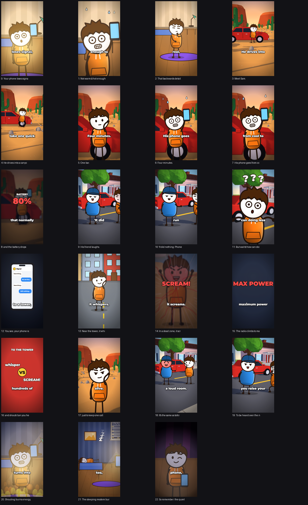
</div>

Selected frames (pulled from the finished MP4):

| | | |
|---|---|---|
| 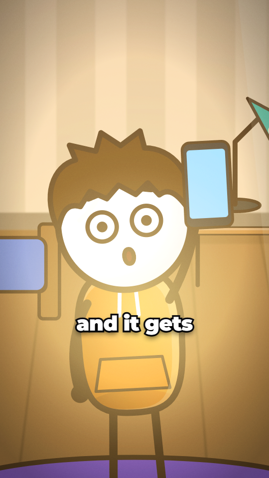 | 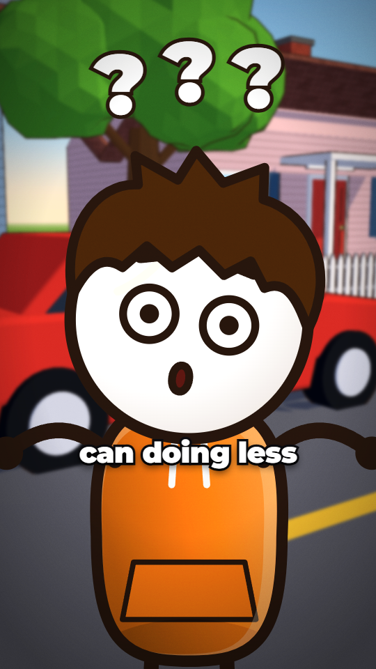 | 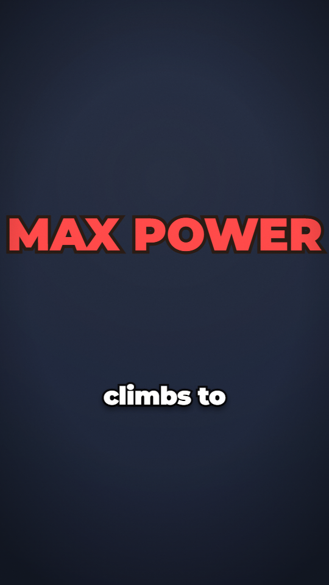 |
| hook, daylight street | turning point | insert: transmit power |
| 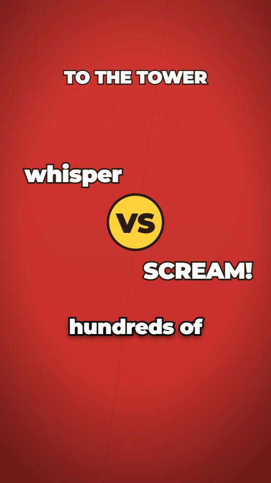 | 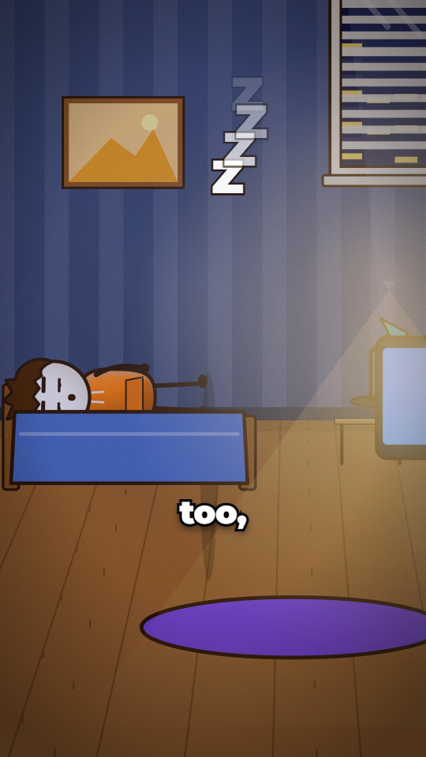 | 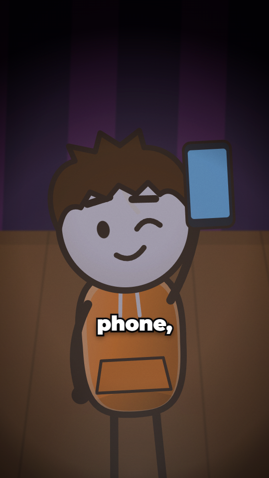 |
| insert: weak vs strong signal | night grade | the phone in the quiet room |

Full video: [`demo/demo.mp4`](demo/demo.mp4).

## Bangla — `bangla-tea-stall-morning`

`/make-video চায়ের দোকানে এক সকাল in Bangla` — 4 shots, dawn, two voices.

<div align="center">
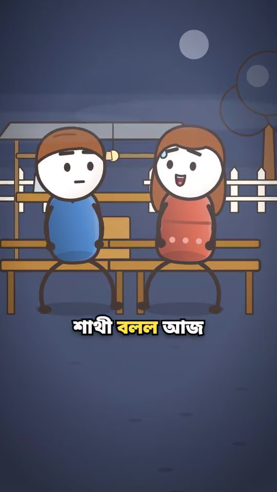
</div>

What to look at: the stall (tin roof on bamboo posts, kettle on the counter, glasses on the shelf,
hanging bulb), the two characters on **separate** benches, the Bangla caption with its conjuncts
intact, and the spoken word highlighted.

## Bangla — `bangla-insert-chart-digits`

A chart and a big-text insert in Bangla, with Bangla digits.

| | |
|---|---|
| 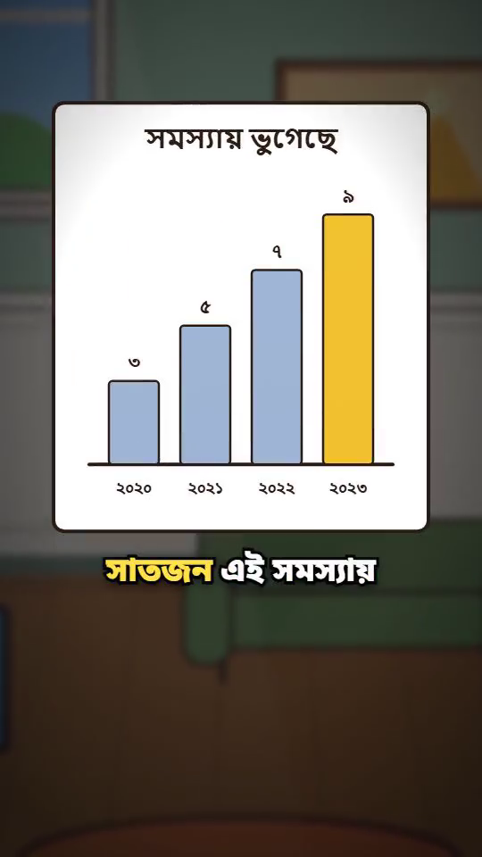 | 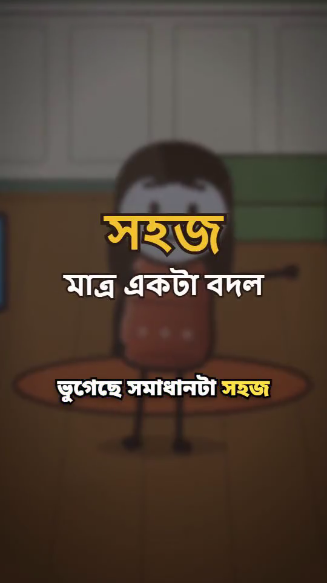 |

Bars labelled ৩ / ৫ / ৭ / ৯, years ২০২০…২০২৩, card raised so the caption band never collides with
the axis labels.

## Bangla — `bangla-dialogue-two`

Two characters, two voices, a tea stall at sunset: the narrator is Nabanita (BD female), Maya is
Nabanita, Rahim is Pradeep (BD male) at a slower rate.

| | |
|---|---|
| 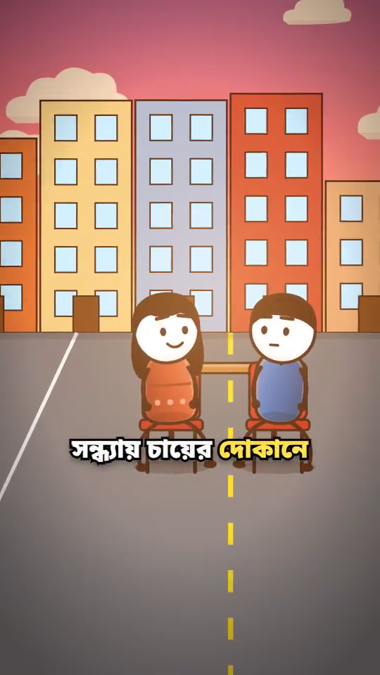 | 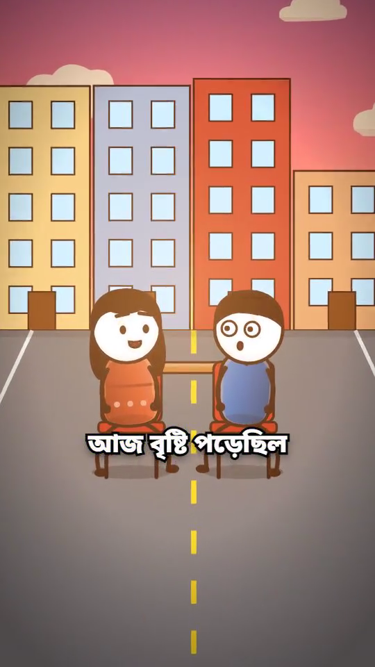 |

## The cases that used to fail

These are the pictures the old gates passed while the film was wrong — a character "sleeping" on the
floor beside the bed, a character "sitting" sunk into the chair. The anchors and the geometry gate
exist because of them.

<div align="center">
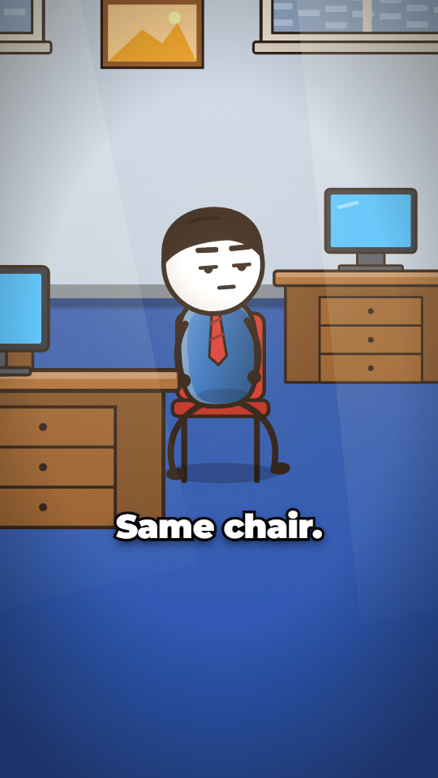
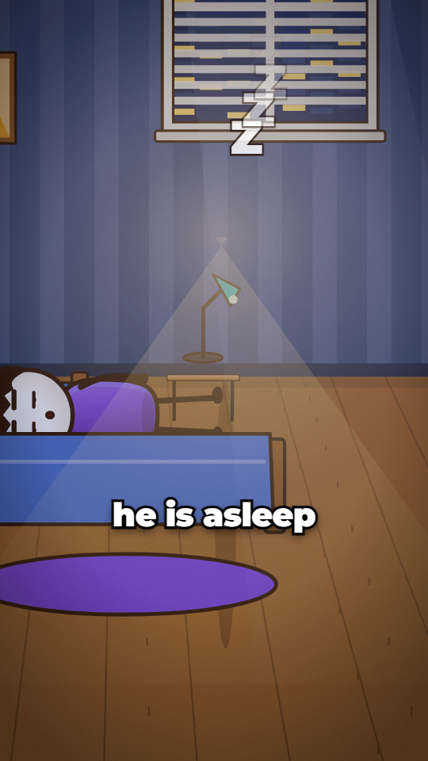

</div>

## How these were produced

```bash
cd engine
npx tsx scripts/studio.ts stories/why-phone-gets-hot.json --tier standard
npx tsx scripts/studio.ts stories/tests/bangla-tea-stall.json --tier draft
npx tsx scripts/studio.ts stories/tests/bangla-insert-test.json --tier draft
npx tsx scripts/studio.ts stories/tests/bangla-dialogue-two.json --tier draft
```

The stills are half-resolution frames copied out of each render; the contact sheets are written by
`qa_visual_report.py` during the `visual` stage.
